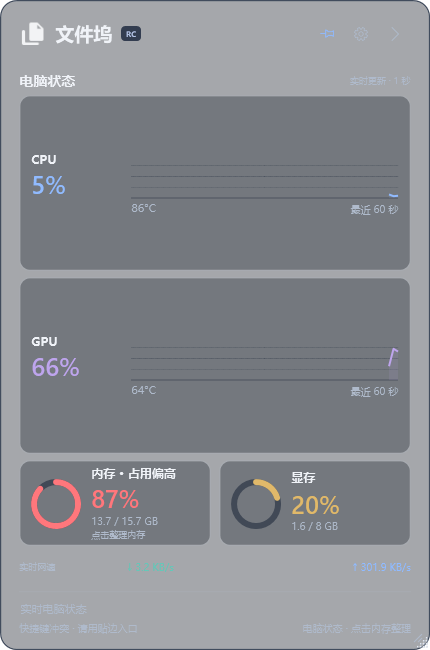
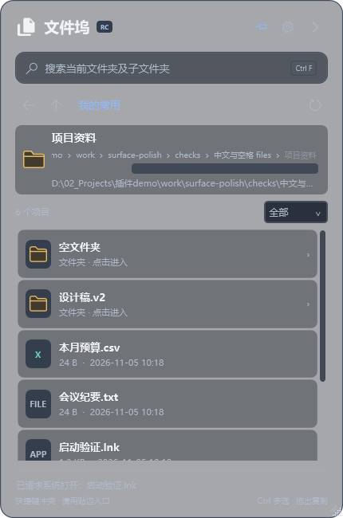

# 文件坞 File Dock

Windows 桌面文件坞：贴边唤出，快速浏览与递归搜索常用文件夹，支持图片预览、多文件拖放与电脑状态监控。

**当前版本：0.8.0-rc.37 · 开源候选版**。Windows x64 · C# / .NET 10 / WPF · [MIT 许可证](LICENSE)

[下载 Windows x64 候选版](https://github.com/dream-shan/file-dock/releases/tag/v0.8.0-rc.37) · [快速开始](#下载与首次使用) · [问题反馈](https://github.com/dream-shan/file-dock/issues/new/choose)

## 界面预览

| 独立性能页 | 文件夹内浏览（示意） |
| --- | --- |
|  |  |

截图由实际程序在隔离验证中渲染，文件为自动生成的样例，不包含维护者的私人文件；性能数值为截图时的采样，不代表日常资源占用或硬件基准测试结果。界面支持跟随系统、浅色和深色主题。

## 能做什么

- **快速访问文件**：从屏幕边缘唤出，添加常用文件夹，在面板内逐层浏览，单击打开文件。
- **找到并使用文件**：递归搜索当前文件夹及子目录，预览图片，Ctrl 多选后整组拖放或复制到支持接收的应用。
- **查看电脑状态**：显示 CPU/GPU 占用与温度、内存/显存及实际网速；性能页展开时每秒刷新，收起后仅保留低频内存提醒。

下载版解压后运行，无需另装 .NET。CPU 温度依赖额外驱动和温度服务，安装步骤见下文；未安装这些组件时仍可使用文件功能。当前为预发布候选版，兼容范围和限制见后文。

## 下载与首次使用

1. 从 [Releases](https://github.com/dream-shan/file-dock/releases) 下载 `FileDock-0.8.0-rc.37-win-x64.zip` 和 `SHA256SUMS.txt`。
2. 将完整 ZIP 解压到自己有写入权限的文件夹，双击 **`FileDock.exe`**。主程序自带运行时，无需安装 .NET，也不要以管理员身份启动，以免影响跨应用拖拽。
3. 点击“我的常用”旁的“＋ 添加”选择文件或文件夹。单击文件夹在面板内浏览，单击文件由默认应用打开。
4. 点击顶部箭头收起，通过贴边入口、托盘或 `Ctrl + Alt + Space` 唤出。使用设置/托盘菜单的“退出”完全关闭。

顶部 `RC` 表示候选版，悬停查看版本。首次运行默认添加程序目录、桌面和文档入口，可自行移除。入口、主题与停靠设置保存在程序旁的 `Data`；添加或移除入口不搬动、不删除原文件。

设置中的「显示模式」统一提供自动、手动和固定置顶。自动模式默认开启：面板位置无遮挡时显示，遮挡或同屏全屏时收起；手动模式主动唤出后显示，点击外部收起；固定置顶在切换普通应用后仍显示。顶部图钉切换固定置顶，再次点击恢复此前模式。手动收起后保持收起，只有入口、托盘或快捷键主动唤出才恢复。托盘唤出保留当前应用焦点。

目前完成过 Windows 11 x64 本地验证及 Windows Server 2025 CI 验证；这不是所有 Windows 版本或硬件的兼容保证。CPU 温度的额外组件见下文，未安装时仍可使用文件功能。主程序尚未进行 Windows 代码签名；SHA256 校验和用于验证完整性，不等同于签名。

## 文件与桌面操作

- **常用入口**：添加文件/文件夹，拖动卡片排序；右键管理、复制路径或打开所在位置。
- **文件夹浏览**：从常用进入的文件夹作为本次浏览起点，第一层隐藏「上一级」，Alt+↑ 同步停用；进入子文件夹后显示，回到起点后再次隐藏。返回按浏览历史跳转，房子按钮直接回到自己的常用清单，路径导航从「我的常用」开始。默认不显示隐藏或系统项目。
- **搜索**：文件页筛选常用项；文件夹内按名称搜索当前目录及全部子目录。清空关键词回到当前层，不搜索文件内容或全盘索引。最多 1000 项，类型筛选应用于已找到的结果。无法读取的子目录会提示；不进入后代目录链接/junction，避免循环。
- **多选与传输**：Ctrl+单击选中或取消，松开 Ctrl 后整组拖出，或 Ctrl+C / Ctrl+V 复制。复制或向外拖放成功后自动清空选中，剪贴板和已传输文件保持有效；失败或取消保留选中。复制处理中再次选文件会开始新批次，松开 Ctrl 本身不会清选。原文件保留，网页需自身支持拖放或粘贴。拖出时暂时隐藏面板，固定置顶时，放下文件后回到原列表。按 Esc 取消拖动也会恢复面板。
- **图片**：列表缩略图、悬停大图、右键复制图片；单击仍由默认应用打开。单张图片复制同时提供图片内容格式，多文件保持独立文件。
- **主题**：默认跟随 Windows 应用主题，也可手动选浅色/深色；托盘随系统任务栏主题保持可见。
- **贴边与唤出**：右侧 `<`、左侧 `>`，20 × 48 逻辑像素入口，空闲半透明、悬停变清晰。支持固定置顶和可选开机启动；不占任务栏或 Alt+Tab 列表。

| 操作 | 快捷键 |
| --- | --- |
| 展开/收起 | Ctrl + Alt + Space |
| 聚焦搜索 | Ctrl + F |
| 多选/取消 | Ctrl + 单击 |
| 复制所选文件 | Ctrl + C |
| 收起面板 / 取消拖拽 | Esc |
| 返回 / 上一级 | Alt + ← / Alt + ↑ |
| 刷新当前文件夹 | F5 |

除外部窗口置顶快捷键可配置外，其他快捷键暂固定。不读取、监听或记录最近使用历史。

## 外部窗口置顶（首版）

- 在普通应用窗口中按 **Ctrl + Alt + T** 切换该窗口置顶；支持同时置顶多个窗口。侧边栏「工具」页的窗口置顶卡片可以修改或禁用此快捷键，注册失败时提示冲突，鼠标入口仍可用。文件坞自身的唤出快捷键保持不变。
- 从侧边栏「工具」页或托盘进入管理；「选择窗口」临时收起面板，点击目标窗口完成操作，Esc 或右键取消选择。操作后通过状态栏或托盘通知反馈。
- 管理列表支持取消单个或全部由文件坞置顶的窗口。原本已经置顶的窗口不接管；窗口关闭后移除会话记录。顶部图钉仍只控制文件坞自身。
- 快捷键设置沿用 Data 的配置保存机制；窗口句柄和标题不写盘。正常退出尝试取消受管理的置顶，失败时明确询问是否继续；强制结束可能留下置顶状态，可关闭目标窗口恢复。
- 无独立后台进程、无桌面轮询；有受管理窗口时才订阅必要窗口事件。普通权限受限的目标明确提示失败；不保证覆盖独占全屏、安全桌面或其他置顶窗口。不包含彩色边框、按应用自动置顶和跨重启恢复。

## 电脑状态

首页展开时每 **1 秒**更新全部指标；收起或进入文件夹后，只每 **2 秒**读取系统内存占用，其他指标暂停。锁屏、断开会话或睡眠期间暂停，恢复后重新采样。CPU/GPU 图表纵轴固定为 0～100%，保留本次展开最近 60 个采样点，悬停查看读数。再次展开重新建立基线；缺失数据留空，不显示为 0。内存/显存用圆环及已用/总容量表示。

CPU 温度独立请求服务，其他指标刷新只读取温度缓存，不等待服务响应。正常约每秒发起一次请求，同时最多一个请求；超过 3 秒未成功更新的温度显示“—”。连接、发送和接收共用 8 秒期限，连接失败或超时后按 2、5、15、30 秒退避重试。收起、切页、锁屏、断开会话、睡眠或退出时取消请求并清空读数，旧请求迟到的响应不再显示；取消客户端等待不能中断服务内部已开始的硬件调用。继续使用现有刷新时机，不新增后台定时器。

| 数据 | 统计方式与限制 |
| --- | --- |
| CPU 占用 | 系统采样；与其他工具刷新窗口不完全一致 |
| GPU 占用 | Windows WDDM GPU Engine 计数器，按显卡与物理引擎汇总各进程后取最繁忙引擎，包含计算/复制/视频引擎。与任务管理器统计原则一致，不保证逐帧相同 |
| GPU 温度、显存 | NVIDIA 驱动；目前不支持其他厂商及同型号多卡。通过 DXGI 匹配显卡，不混合核显、独显或远程映射；匹配/计数器失败显示“—” |
| CPU 温度 | LibreHardwareMonitor、PawnIO 与本机专用温度服务；硬件不支持或服务不可用时显示“—” |
| 网速 | 活动物理网卡的实际上传/下载速率，过滤虚拟网卡；不主动下载测速，不代表宽带上限 |

收起后暂停采样不等于进程零内存。WPF 与自包含运行时存在基础开销；短时测试不能证明长期无泄漏。

## CPU 温度组件

主程序保持普通权限。温度由 `FileDockTemperature` 服务按请求读取；服务使用系统的 .NET Framework 4.8，安装在 `C:\Program Files\FileDockTemperature`，无请求时不采样。普通用户对服务目录仅有读取权限；本机命名管道仅提供温度与采样计数，不接收执行命令、文件路径或远程连接。

首次使用 CPU 温度：

1. 从 [PawnIO 官方网站](https://pawnio.eu/) 安装签名驱动。当前组件使用 LibreHardwareMonitor 0.9.6、PawnIO 2.2.0；驱动不在 ZIP 中，读数依赖硬件支持。
2. 以管理员身份打开 PowerShell，进入解压目录，安装包内服务：

~~~powershell
.\TemperatureService\Install.ps1 -SourceDirectory .\TemperatureService
~~~

正常启动文件坞之后不需要管理员权限。温度服务新增硬件初始化与更新失败后的资源清理和恢复：后续采样请求按 2、5、15、30 秒退避重试，无请求时不重试；读取成功但没有有效温度时不反复重建硬件对象。要使用本轮修复，已安装的服务需用新构建组件运行上述安装命令更新；源码构建者改用 `源码\TemperatureService\Install.ps1 -SourceDirectory .\重建输出\TemperatureService`。故障诊断仅在服务目录的 `Diagnostics` 中保留两个最多 64 KB 的文件，每 30 秒至多写入一次阶段、异常类型和错误码，不记录异常消息或私人路径。

卸载服务时，退出文件坞后在管理员 PowerShell 运行：

~~~powershell
Stop-Service FileDockTemperature
sc.exe delete FileDockTemperature
~~~

确认服务已停止、删除后，可移除上述服务安装目录。PawnIO 从 Windows 已安装的应用卸载；其他监控软件也需要它时应保留。

## 升级、回退与卸载

配置保存使用独立状态快照和单一后台写入队列，沿用原 JSON、原子替换和备份恢复。位置、尺寸、主题等设置立即生效，连续修改约 400 毫秒合并保存；待办、重要日和常用入口在保存成功后提交，失败时保留原数据，编辑表单保留输入以便重试。退出会等待已提交操作并立即保存剩余设置；失败时可重试、返回程序，或明确放弃未保存设置后退出。突然断电或强制结束进程仍可能丢失尚未落盘的最新修改。

1. 从菜单退出旧程序，备份整个旧目录，尤其是 `Data`。
2. 将新包解压到原目录，保留原 `Data`。从 Demo 文件名升级时，改为启动 `FileDock.exe`；把旧 `FileDockDemo.exe` 移到备份目录，并更新桌面/任务栏快捷方式。
3. 首次启动仅自动迁移指向**同目录旧 exe** 的现有开机启动项。不会开启原本关闭的启动项，也不会覆盖另一安装目录或带自定义参数的命令。若提示更新失败，在设置里重新开启开机启动。
4. 移动安装目录后，应重新设置开机启动和快捷方式；首次正常启动前不要删除备份。

回退时先退出新版，恢复升级前整套备份。较新版配置不应直接交给旧版程序；遇到“配置版本较新”提示时，应使用对应新版或升级前的配置备份。正常损坏配置可从程序保留的备份恢复。

卸载主程序前先关闭开机启动，再退出并移除程序目录，保留需要的 `Data` 备份。此操作不会删除入口指向的文件，也不会自动卸载温度服务/驱动。

## 已知兼容限制

- **截图隐藏**：在运行文件坞的电脑上，Snipaste 默认 F1 / Ctrl+F1、PrintScreen 或 Win+Shift+S 触发时临时隐藏入口，结束后恢复；未启动截图时约 1.5 秒恢复。展开面板保留画面，同时临时停止鼠标交互和置顶，让截图层接管；结束或取消后恢复原状态且不抢焦点。其他工具、自定义热键、菜单启动和远程控制端截图不保证提前隐藏。入口不持续排除屏幕采集，以便远程/投屏画面中可见。Snipaste 中鼠标移到面板顶部空白处可自动识别整个窗口；若启用了界面元素检测，指向按钮可能选中按钮，可按 Tab 切换窗口/元素检测。
- **全屏与桌面**：适用于普通窗口、最大化和无边框全屏；独占全屏游戏、安全桌面及其他虚拟桌面不保证覆盖。多屏缩放切换和实际登录后的开机启动仍需环境验证。
- **拖放**：目标应用必须接收相应格式，权限级别也会影响拖放；不能保证所有网页支持。复制文件不等于自动上传。
- **图片**：PNG/JPEG/BMP/GIF（首帧）使用系统解码器，WebP 等依赖解码支持；不支持时保留文件打开和拖拽。超过 100 MB 或 2 亿像素跳过预览；超过 3200 万像素的图片复制时仅提供原文件。缩略图缓存最多 64 项，按可见区域加载。

## 内存提醒与手动整理

内存圆环及百分比随占用连续渐变：50% 以下青绿，50%～65% 过渡到黄，65%～80% 过渡到红，80% 以上保持红色。贴边入口在 65% 以上逐步染色，超过 80% 为红色；约 300 毫秒过渡，无持续动画。占用偏高提示超过 80% 出现、低于 78% 消失。颜色适配浅色/深色主题，窗口尺寸不变。

点击内存卡片（或 Tab 聚焦后按 Enter/空格）手动整理：清除文件坞可重建的缩略图缓存，并调用 Windows EmptyWorkingSet 尝试整理同一用户、同一会话中的普通后台应用。跳过文件坞、展开前的前台应用、当前前台应用、Windows 目录中的组件、关键/提权/无权限进程。不会关闭应用，不申请管理员权限，不清空系统待机列表，也不操作显存。操作及动画期间禁止重复触发。点击后圆环约 0.25 秒归零，整理完成后约 0.5 秒回到最新实测占用，随即恢复点击，无额外冷却；百分比数字始终为实际读数。

工作集整理不保证提速或释放指定容量，可能引起短暂延迟且占用可能回升；完成提示展示系统实际前后占用，变化也受其他应用影响。收起后的两秒检查只调用系统内存接口，不遍历进程或读取 CPU/GPU/温度。进程遍历只发生在主动整理时。

## 内部模块边界（第一轮）

当前仍发布一个完整主程序，不是动态插件系统。待办已经集中到 `源码/Features/Planner`：`UI` 负责展示与输入，`Application/PlannerController` 负责操作与保存失败处理，`Domain` 保存原有模型和日期规则；`PlannerModule` 管理显示、隐藏和退出时的资源。

待办通过 `Contracts/ModuleContracts` 申请弹窗、关闭确认、状态提示和焦点恢复，通过 `IPlannerStore` 提交数据；`Infrastructure/AppStatePlannerStore` 接回现有 AppState、原子 JSON 保存及备份。模块内部不访问 MainWindow、AppState 或磁盘路径。文件和性能仍沿用原结构，留待下一轮拆分。

## 本候选版变化

- 新增侧边「工具」页，窗口置顶改为页面卡片，选择窗口、管理列表和快捷键设置集中在一处；托盘管理入口打开该页面。原有文件、安排和性能页面及唤出方式保留。

- 新增自研外部窗口置顶模块：快捷键切换、鼠标选取、管理列表、单个/全部取消、自定义快捷键与正常退出恢复。接入工具页、托盘、配置保存和完整验收。

- 文件传输按批次结束选择：复制或向外拖放成功后清除高亮，下一次 Ctrl 多选不会夹带上一批。取消、拒绝和失败保留选择；复制处理中开始的新选择独立于旧批次，旧操作完成不会误清新选择。常用项内部排序仍保持原有交互。

- 统一自动、手动、固定置顶三种显示模式。图钉直接固定置顶，切换普通应用后仍显示；主面板与标签同步覆盖。取消图钉恢复此前模式；手动收起后，返回桌面也不会自行弹出。旧图钉或置顶设置自动迁移，个人内容与位置保留。

- 配置改为快照后台串行保存，连续设置修改合并写盘；待办、重要日和常用入口统一处理保存失败，退出前等待保存并支持重试或取消退出。新增慢写入、并发修改、失败恢复和退出策略验证，保留现有配置格式与备份保护。

- CPU 温度请求与其他性能采样隔离：慢响应不再拖住 CPU、内存、GPU 和网速刷新；增加读数过期、异步管道统一超时、失败退避及页面/会话生命周期取消，保持服务来源校验。新增缓存、管道故障及界面采样隔离自测。此项更新主程序即可生效，服务协议保持兼容。

- 温度服务在硬件初始化或更新抛出异常后清理对象，并在后续请求中退避重试；新增不访问真实硬件的恢复、采样节流和诊断限频/轮转自测，接入现有验收脚本。此修复需更新已安装的温度服务后生效。

- “安排”页统一重要日期与今日清单。日期卡以小日历、名称和剩余天数分列展示，待办合并为透明清单；顶部添加菜单可新建待办或重要日期，“全部待办”管理完整计划。

- 顶部固定、设置和收起按钮采用透明底色与轻描边光晕，悬停或按下时显示淡色反馈；图钉选中状态和键盘焦点独立显示。

- 统一深浅主题、字号和圆角层级。文件页常用入口改为单列轻列表，完整行展示名称与路径；文件夹采用统一轮廓图标，多选后底部提供复制按钮。保留虚拟化、搜索、排序、图片预览和拖放。
- 性能页采用 CPU/GPU 横向趋势区与并排内存圆环，最小窗口仍可查看容量和网速；安排页统一清单排版与顶部添加入口，编辑表单保留紧凑布局。

- 内容底板采用更轻的分层半透明：标题、分区标题、网速及底部提示共用外壳底色，不再各自铺条状背景。在默认空白透明度 60% 时，指标卡片合成后约 30%–36% 透明，搜索框约 20% 透明；细轮廓区分卡片，文字、图标和曲线保持不透明。保留个人空白透明度设置，菜单及编辑弹窗仍使用实色底板。
- 三个侧边标签同步采用半透明底色：普通状态约 30% 透明，选中和悬停约 20% 透明；连接处不再铺实色，图标与选中边框保持清晰，深浅主题及左右贴边一致。
- 默认贴边展开取消横向留白，停靠位置随宽度调整保持贴边；拖离边缘后保留自由位置，靠近边缘可重新停靠。旧版靠近停靠边缘的位置自动迁移，保留纵向位置和个人数据。

- 修复贴边入口仍处于显示状态但被应用遮挡的问题：显示和恢复时核验原生窗口置顶标志，置顶被撤销时通过窗口事件恢复，自动收起期间同步检查；不增加轮询，不抢焦点。截图期间继续隐藏入口，结束后恢复。诊断记录补充入口实际置顶状态。

- 同时支持 Windows 原生边角缩放和自定义缩放柄的尺寸保存；系统缩放结束后保存实际窗口尺寸，重启可恢复。

- 默认主面板改为 380 × 500 逻辑像素，三个页面使用相同尺寸；收紧标题、搜索框间距与常用卡片，保持文字可读。手动调整大小后保存尺寸，重启恢复；设置中可恢复默认大小。尺寸随系统缩放，屏幕空间不足时限制在工作区内。旧配置首次升级采用紧凑尺寸，个人数据保留。

- 待办页新增重要日倒计时：支持公历日期、天数同步填写、一次性和每年重复；默认展示最近两项，可折叠或查看全部，点击编辑与删除。一次性到期后隐藏，每年重复在次日转入下一年；2 月 29 日在非闰年按 2 月 28 日计算。仅复用待办页日期检查，无新增后台计时器。

- 拆分为文件、待办、性能三个独立页面。文件页常用区使用完整高度；安排页独立显示日期、管理、清单与顶部添加菜单，不显示文件搜索。切页保留目录、搜索、选择以及待办管理和滚动位置。首次启动仍默认性能页，之后记住所选页面。
- 仅性能页展开时采集完整硬件数据；待办页可见时才检查日期，文件页可见时才监听目录，其他页面及收起时保留轻量内存检测。三个侧边标签继续支持左右换边、主题同步和主面板单独截图。

- 空白区域默认透明 60%，标题、卡片和搜索框使用分层半透明底板，文字和图标保持完整不透明；可在设置的空白区域透明度中预览调节（0–85%），关闭子菜单后保存，支持恢复默认。深浅主题、菜单及编辑弹窗分别处理，不采用整窗淡化或新增后台刷新。透明区域仍可拖动，不穿透点击；保留独立标签和主面板截图边界。

- 侧边标签改为附属工具窗口，保持可见并随主面板移动、显隐、换边和主题同步。主面板原生窗口边界仅覆盖主面板，方便截图工具自动框选时排除标签；截图时继续屏蔽误点击，结束后恢复。主面板内容尺寸保持不变，并迁移旧版展开位置。
- 更新后请从资源管理器亲自双击 FileDock.exe 启动日常使用版本，避免使用开发工具启动的测试进程。

- 第一轮内部模块化：待办界面、控制器、规则集中到 Features/Planner，通过内部宿主与存储接口接入。新增／编辑／完成／删除／撤销／跨天清理不再由界面直接修改全局配置；原 JSON、界面与待办规则保持兼容。主窗口统一承载模块弹窗，生命周期负责隐藏暂停与退出释放；暂不支持单独下载或安装模块。

- 重排待办弹窗：类型和规律采用统一分段控件，星期按钮单行排列，循环天数可直接输入或加减，日期整行点击，七天安排以独立日期块展示；沿用原有出现和清理规则。小窗口仅正文滚动，底部操作固定。

- 待办改为一次性／重复：一次性只在执行日期出现，过日后清理；重复支持每天、每周指定日期、做几天停几天，并提供七天预览。完成项淡化后排在未完成项下，不累计每日历史或未完成欠账。
- “管理”可编辑未来、休息日和旧计划。旧记录迁移为一次性并标注“旧计划 · 请确认日期”，确认前不会自动清理；升级前备份 Data。清单可见时每 30 秒只检查本地日期，收起停止，重新展开自动核对。
- 新建窗口保留计划输入、类型、执行／开始日期，不含提醒、定时生成、截止日期或周期分页。
- 修正侧边标签外侧的整窗矩形边框：关闭系统附加边框，保留自定义窗口轮廓；选中标签与面板平直衔接，标签空隙继续透出桌面且不拦截点击。

- 新增外侧“文件 / 性能”标签，首次启动默认显示性能，之后记住所选页面；左右贴边自动镜像。文件页独立显示常用、搜索和浏览，切换保留目录、搜索、选择和滚动位置。性能页每秒更新；文件页及收起时仅保留轻量内存检测，隐藏文件夹暂停监听，返回后同步变化。

- 收起入口随内存占用平滑增强颜色和不透明度；超过 80% 时显示清晰的红色背景与浅色箭头，低于 78% 后恢复渐变。鼠标悬停显示当前占用。

- 自动模式只在上方窗口与面板实际重叠或同屏全屏时收起，窗口移开、关闭或最小化后恢复，不抢焦点；手动模式只响应主动唤出。
- 主动唤出临时浮到应用上方，返回其他应用后按模式判断；固定置顶始终覆盖普通应用。透明度只控制外观，不启用点击穿透。
- 手动收起优先于所有模式；切换应用或返回桌面都不会自行弹回，主动唤出才恢复。
- 截图、菜单、文件对话框、拖放、移动及内存整理期间暂停自动切换；窗口事件合并处理，无空闲轮询。
- 显示模式互斥，不再叠加独立开关；旧配置的保持展开或始终置顶迁移为固定置顶，保留文件入口、位置、主题。固定置顶不保证覆盖独占全屏和系统安全界面。

## 构建与发布验收

Windows x64 上安装 `global.json` 指定的 **.NET SDK 10.0.403**。不需要预装 Visual Studio 或温度服务；构建从官方 NuGet 还原 .NET Framework 4.8 引用程序集。

~~~powershell
powershell -NoProfile -ExecutionPolicy Bypass -File .\源码\Build.ps1
~~~

结果在 `重建输出`：`FileDock.exe`、`TemperatureService` 和运行时许可。输出目录必须不存在或为空，重建可指定新的 `-OutputDirectory`。主程序运行时锁定 10.0.14；两项目使用 NuGet 锁文件与 locked restore。依赖升级应显式更新版本及锁文件、核对许可，不删除锁文件绕过检查。

源码项目名、命名空间、单实例标识和启动注册值保留历史名称，以减少无关重命名并兼容旧安装；分发文件与用户界面使用 File Dock。图标母版是 `源码/Assets/FileDock.svg`，PNG/ICO 已包含；修改后可运行 `源码/Assets/Build-Icons.ps1` 重建。

在干净、已提交的 Git 检出中生成候选包：

~~~powershell
powershell -NoProfile -ExecutionPolicy Bypass -File .\源码\Release.ps1
~~~

流程检查源文件边界、命名与文档一致性，构建主程序/服务，运行集成自测，再按白名单打包、校验逐文件哈希。仅 `artifacts/<版本>/FileDock-<版本>-win-x64.zip` 与 `SHA256SUMS.txt` 可分发；其余是内部构建/测试材料。输出目录存在时不会覆盖。

包内 `build-info.json` 记录版本、提交、SDK/运行时和逐文件 SHA256，不记录本机路径、用户名或时间。压缩项排序且固定时间；不保证不同操作系统/压缩库产生逐字节相同 ZIP。运行时许可取自实际还原包，温度服务从本次源码构建。

GitHub Actions 在 PR/main 上检查；版本一致的 `v*` 标签触发预发布 Release，发布的是同一次 CI 验证过的包。发布说明取自包内本候选版变化，不上传原始测试截图或性能记录。

~~~powershell
Get-FileHash .\FileDock-0.8.0-rc.37-win-x64.zip -Algorithm SHA256
~~~

对照 `SHA256SUMS.txt`；源码检出中可运行 `源码\Verify-Package.ps1 -Archive <ZIP路径> -ExpectedCommit <完整提交号>` 验证结构和内容。

自测用 `源码\Test.ps1 -Executable .\重建输出\FileDock.exe -ResultDirectory <新的测试目录>`。包含配置保存/恢复、递归搜索、文件夹导航、多选、图标主题、布局、开机启动路径迁移规则和 60 次展开/收起。资源检查预热 30 次、测量 30 次，结果为本地 `resource-check.txt`，不等同日常空闲占用或长期泄漏证明。真实鼠标拖放、截图隐藏、全屏唤出和硬件读数需要交互桌面另外验证；CI 通过不代表所有外部软件/硬件已兼容。

## 隐私、反馈与开源边界

文件坞没有账号、遥测上报或远程文件索引。个人配置在 `Data`；温度服务只使用本机管道。文件打开、复制和拖放按用户操作交给目标应用，后续上传由目标应用负责。构建/依赖审计访问 NuGet，CI 和下载由 GitHub 提供。

个人配置、备份、构建产物和测试记录不入库或下载包。反馈问题请提供版本（悬停 RC 查看）、系统版本、复现步骤、预期与实际结果；硬件问题可补充型号及数据来源。先隐去截图/日志中的私人路径与文件名，不要上传整个 `Data`。存在令牌或私密数据的问题不要提交公开 Issue。

维护者：Zongcheng Chen（GitHub：dream-shan）。维护者选择使用真实姓名与邮箱进行提交署名，提交署名随仓库公开；贡献者可自行选择真实署名或 GitHub 隐私邮箱。仓库公开仅涉及项目中的内容，不会自动公开维护者的其他私人资料。

项目许可见 [LICENSE](LICENSE)，第三方版本、许可与源码链接见 [THIRD-PARTY-NOTICES.md](THIRD-PARTY-NOTICES.md)，运行时许可随包提供。
